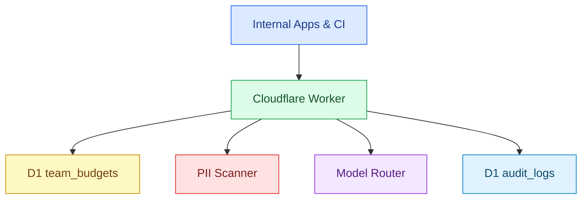
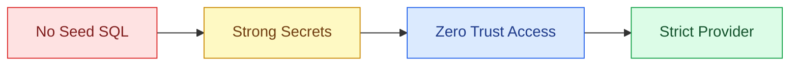
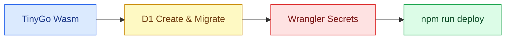
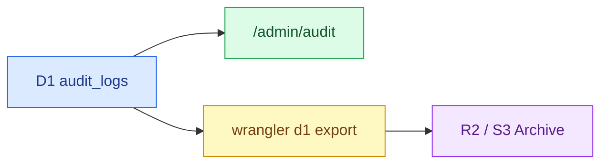

# Enterprise Deployment Guide (`company-deployment.md`)

This guide covers deploying **Go AI Gateway** as a centralized, multi-team AI traffic control plane in an enterprise environment on **Cloudflare Workers**, **Cloudflare D1**, **Workers AI**, and external enterprise LLM accounts.

> **One-Command Enterprise Automation (`deploy-company.sh`)**:
> ```bash
> ./deploy-company.sh --init-only                  # Creates hardened .env.company (chmod 600) with generated ADMIN_TOKEN
> # Add enterprise vendor API keys to .env.company, then preview and deploy:
> ./deploy-company.sh --dry-run
> ./deploy-company.sh --teams-file teams.json      # Deploys Worker + D1 + secrets and provisions all teams
> ```
> `deploy-company.sh` enforces production guardrails (rejects placeholder `ADMIN_TOKEN` and blocks `SEED_DEMO_TEAMS=true`), delegates Wasm/D1/secrets deployment to [deploy-cloudflare.sh](deploy-cloudflare.sh), and saves any auto-generated team keys to `company-team-keys.txt` (`chmod 600`).

---

## 1. Enterprise Topology



```
Internal Apps, CI/CD, Support Tools, IDE Agents
  ├─ OpenAI SDK   ──▶ POST /v1/chat/completions
  ├─ Anthropic SDK ─▶ POST /v1/messages
  └─ Gemini SDK   ──▶ POST /v1beta/models/{model}:generateContent
         │
         ▼
  Cloudflare Edge Worker (TinyGo Wasm + Zero Trust Access on /admin/*)
    ├── Team Auth & Monthly Budget Caps ──▶ Cloudflare D1 (team_budgets)
    ├── PII & Secret Redaction / Blocking ─▶ In-Worker Scanner (internal/redact)
    ├── Policy-Aware Model Router         ─▶ Workers AI / Enterprise Vendor APIs
    └── Tamper-Evident Audit Trail        ─▶ Cloudflare D1 (audit_logs)
```

---

## 2. Pre-Production Security Checklist



1. **Remove Demo Seed Data**:
   Do **not** apply `migrations/0002_seed.sql` to production D1. Only run `migrations/0001_init.sql` (or delete `0002_seed.sql` before running `wrangler d1 migrations apply --remote`).
2. **Generate High-Entropy Secrets**:
   - `ADMIN_TOKEN`: 32+ bytes random secret (`openssl rand -hex 32`), stored via `wrangler secret put ADMIN_TOKEN`.
   - Team keys: unique random keys per tool/team (`gw_prod_<team>_<random>`). Only `SHA-256` digests are stored in D1.
3. **Restrict Control-Plane Routes**:
   Put **Cloudflare Access** (Zero Trust SSO / IdP policy) in front of `/`, `/admin/*`, and `/healthz` while leaving `/v1/*` and `/v1beta/*` reachable by internal services using team Bearer / API keys (or behind private Cloudflare Tunnel / mTLS).
4. **Choose Strict vs. Failover Routing**:
   - Standard tools: allow automatic fallback from external vendors to Cloudflare Workers AI if an external vendor returns 5xx.
   - Regulated workloads requiring a specific BAA/DPA vendor only: enforce `X-Gateway-Strict-Provider: true` at the client/proxy layer so unconfigured vendors fail closed (`503`).

---

## 3. Provisioning Cloudflare Infrastructure



### 3.1 Build the TinyGo Wasm Bundle

```bash
npm install
make build-wasm
# Outputs ./build/app.wasm (~2.4 MB), worker.mjs, runtime.mjs, wasm_exec.js
```

### 3.2 Create & Migrate Production D1

```bash
npx wrangler d1 create ai-gateway-prod-db
```

Update `wrangler.jsonc` with your production `database_id` (and use separate `env.production` / `env.staging` blocks if maintaining multiple environments):

```jsonc
{
  "name": "go-ai-gateway",
  "main": "./build/worker.mjs",
  "compatibility_date": "2025-04-01",
  "build": { "command": "npm run build" },
  "ai": { "binding": "AI" },
  "d1_databases": [
    {
      "binding": "DB",
      "database_name": "ai-gateway-prod-db",
      "database_id": "<PRODUCTION_D1_UUID>",
      "migrations_dir": "migrations"
    }
  ],
  "vars": {
    "AI_GATEWAY_ID": "enterprise-ai-gateway"
  }
}
```

Apply only schema migration `0001_init.sql` in production:

```bash
npx wrangler d1 execute ai-gateway-prod-db --remote --file=./migrations/0001_init.sql
```

### 3.3 Configure Enterprise Vendor Secrets

Set `ADMIN_TOKEN` and whichever enterprise vendor API keys your organization contracts with:

```bash
npx wrangler secret put ADMIN_TOKEN
npx wrangler secret put ANTHROPIC_API_KEY
npx wrangler secret put GEMINI_API_KEY
npx wrangler secret put OPENAI_API_KEY
npx wrangler secret put XAI_API_KEY
npx wrangler secret put DEEPSEEK_API_KEY
npx wrangler secret put QWEN_API_KEY
npx wrangler secret put MISTRAL_API_KEY
```

Optional:
- `PROVIDER_LIMITS_USD`: global monthly safety caps across all teams (e.g. `openai=500,anthropic=500,grok=100`).
- `UPSTREAM_BASE_URL` & `UPSTREAM_API_KEY`: route custom models to an internal vLLM / Azure OpenAI / Bedrock proxy.
- `AI_GATEWAY_ID` in `wrangler.jsonc` `"vars"`: mirrors `env.AI.run(...)` telemetry through Cloudflare AI Gateway analytics.

### 3.4 Deploy

```bash
npm run deploy
```

---

## 4. Onboarding Teams & Enforcing Policies


Provision each department/application with its own key, budget, tier ceiling, and PII policy:

```bash
# Regulated Customer Support: block any prompt containing PII, cap at balanced tier ($150/mo)
curl -X POST https://ai-gw.internal.company.com/admin/teams \
  -H "Authorization: Bearer $ADMIN_TOKEN" \
  -H "Content-Type: application/json" \
  -d '{
    "team_id": "customer-support",
    "team_name": "Customer Support",
    "api_key": "'"$(openssl rand -hex 24)"'",
    "monthly_limit_micros": 150000000,
    "max_tier": "balanced",
    "pii_mode": "block",
    "enabled": true
  }'

# Platform Engineering: redact PII automatically, allow reasoning tier ($500/mo)
curl -X POST https://ai-gw.internal.company.com/admin/teams \
  -H "Authorization: Bearer $ADMIN_TOKEN" \
  -H "Content-Type: application/json" \
  -d '{
    "team_id": "platform-eng",
    "team_name": "Platform Engineering",
    "api_key": "'"$(openssl rand -hex 24)"'",
    "monthly_limit_micros": 500000000,
    "max_tier": "reasoning",
    "pii_mode": "redact",
    "enabled": true
  }'
```

### Rotating a Compromised Team Key

Call `POST /admin/teams` with the existing `team_id` and a new `api_key`. Only the new `SHA-256` hash becomes active; spend and audit history are preserved.

---

## 5. Pointing Internal Tools to the Gateway

- **OpenAI SDK / Python / Node**:
  - `OPENAI_BASE_URL=https://ai-gw.internal.company.com/v1`
  - `OPENAI_API_KEY=<team_api_key>`
- **Anthropic SDK**:
  - `ANTHROPIC_BASE_URL=https://ai-gw.internal.company.com`
  - `ANTHROPIC_API_KEY=<team_api_key>`
- **Google Gemini SDK / REST**:
  - Endpoint: `https://ai-gw.internal.company.com/v1beta/models/{model}:generateContent`
  - Header: `x-goog-api-key: <team_api_key>`
- **Attribution Header**: Set `X-Tool-Name: <service-or-cli-name>` on all internal clients so `audit_logs` tracks spend per tool within each team.

---

## 6. Auditing, Compliance & Operations



- **Live Telemetry**:
  - `GET /admin/summary` — organization-wide spend, token totals, PII detections, and blocked requests.
  - `GET /admin/audit?pii_only=1&limit=100` — inspect every request where PII/secrets were detected or blocked (raw PII values are **never** stored).
  - `GET /admin/providers` — inspect per-vendor spend vs. configured `PROVIDER_LIMITS_USD`.
- **D1 Time Travel & Export**:
  Use `wrangler d1 export ai-gateway-prod-db --remote --output=audit-backup.sql` on a scheduled CI job to archive immutable `audit_logs` to cold object storage (R2/S3).

