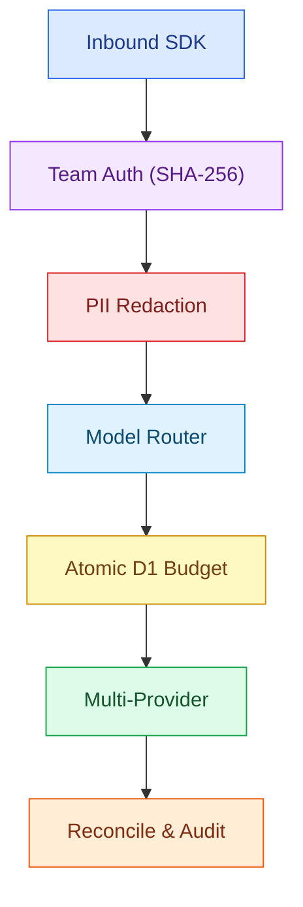
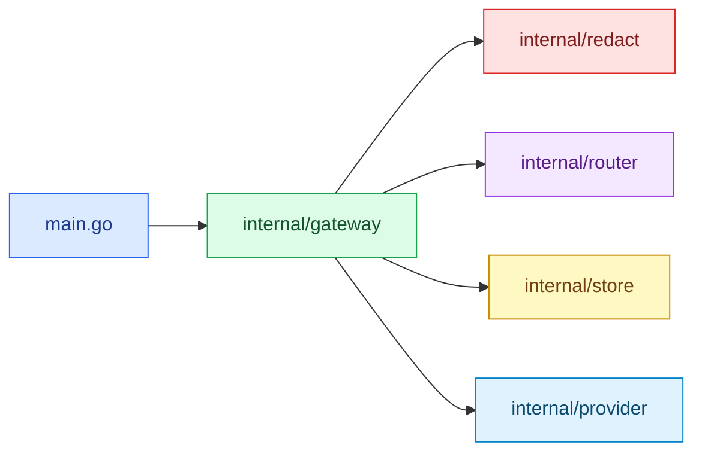
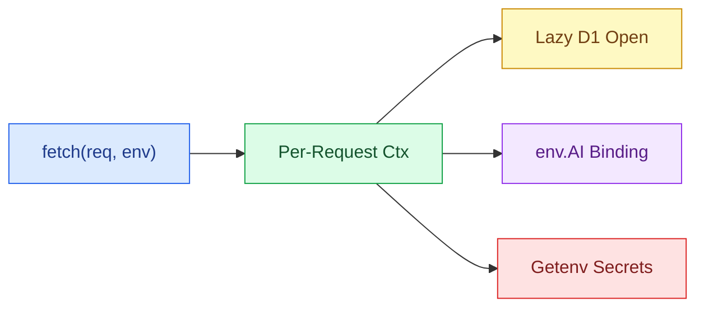

# Architecture Guide

The **Go AI Gateway** sits between every internal tool (CLIs, CI bots, backend services, notebooks, IDE agents) and LLM providers. It normalizes inbound SDK traffic, enforces security and spend controls, routes to the best available model, and records a tamper-evident audit trail.

## Request Lifecycle



```
Internal Tool (OpenAI SDK / Anthropic SDK / Gemini SDK / curl)
   │
   ▼
[1. Inbound Protocol Adapter]  (internal/gateway/adapters.go, gateway.go)
   ├─ POST /v1/chat/completions
   ├─ POST /v1/messages
   └─ POST /v1beta/models/{model}:generateContent
   │
   ▼
[2. Team Authentication]       (internal/store)
   ├─ SHA-256(API key) lookup against team_budgets
   ├─ Automatic UTC monthly rollover (YYYY-MM)
   └─ Rejects unknown/disabled teams (logged as unauthorized / blocked_policy)
   │
   ▼
[3. PII & Secret Redaction]    (internal/redact)
   ├─ Scans messages before leaving the gateway
   ├─ redact: replaces with deterministic placeholders ([REDACTED_EMAIL_1], ...)
   ├─ block: rejects request with 400 and logs blocked_pii
   └─ audit_only: records finding counts without mutating prompt
   │
   ▼
[4. Model Router & Policy]     (internal/router)
   ├─ Resolves model ID, alias, or "auto" complexity/code/hint routing
   ├─ Enforces team max_tier (clamps "auto", rejects explicit escalation with 403)
   └─ Checks provider availability; falls back to Workers AI if unconfigured
   │
   ▼
[5. Atomic Budget Reservation] (internal/store)
   ├─ Computes worst-case cost across primary & fallback candidates
   ├─ D1 single-statement conditional UPDATE (no BeginTx required)
   └─ Rejects with 429 insufficient_quota if monthly_limit_micros exceeded
   │
   ▼
[6. Multi-Provider Dispatch]   (internal/provider)
   ├─ Workers AI (env.AI.run binding in Wasm, REST API in standalone)
   ├─ Anthropic (/v1/messages)
   ├─ Google Gemini (/v1beta/models/...:generateContent)
   ├─ xAI Grok, DeepSeek, Qwen, OpenAI, Mistral, Custom OpenAI-compat
   └─ Walks fallback chain on upstream error; refunds 100% if all fail
   │
   ▼
[7. Reconciliation & Audit]    (internal/store)
   ├─ Adjusts spent_micros to exact token cost (micro-dollars)
   ├─ Writes immutable row to audit_logs (never storing raw PII)
   └─ Returns native OpenAI / Anthropic / Gemini response + X-Gateway-* headers
```

## Package Structure



| Package | Responsibility |
| --- | --- |
| `main.go` | Entrypoint calling `workers.Serve(gw)` (runs on Workers Wasm or local `net/http`) |
| `runtime_js.go` | `//go:build js && wasm` wiring for Cloudflare D1, `env.AI`, and `cloudflare/fetch` |
| `runtime_local.go` | `//go:build !js` wiring for in-memory store and REST/mock providers |
| `internal/types` | Canonical OpenAI-compatible request/response, `TeamBudget`, `AuditEntry`, `GatewayMeta` |
| `internal/redact` | PII/secret scanner & deterministic session placeholder engine |
| `internal/router` | Multi-vendor model catalog, micro-dollar pricing, complexity router, tier enforcement |
| `internal/store` | `Store` interface, `D1Store` (`database/sql`), and `MemoryStore` |
| `internal/provider` | `MultiProvider`, `WorkersAIJSProvider`, `AnthropicProvider`, `GeminiProvider`, `OpenAICompatProvider`, `WorkersAIRESTProvider`, `MockProvider` |
| `internal/gateway` | HTTP mux, inbound adapters, control-plane pipeline, Admin API, embedded dashboard |

## TinyGo & Cloudflare Workers Runtime Design



Running Go on Cloudflare Workers via **TinyGo** (`-target wasm`) and `github.com/syumai/workers-go` imposes two important runtime constraints that shape this codebase:

1. **Per-Request Binding & Env Resolution**:
   In `workers-go`, `cfruntimecontext` (`env.DB`, `env.AI`, and `cloudflare.Getenv(...)`) is populated per incoming `fetch(request, env, ctx)` event — **not** during `main()` startup before `workers.Serve()`.
   - `D1Store` opens `sql.Open("d1", "DB")` lazily inside each operation (`withDB`) and closes cleanly when done.
   - `WorkersAIJSProvider` fetches `cloudflare.GetBinding("AI")` inside `Chat(...)`.
   - `MultiProvider.HasFunc` / `DynamicLookup` and `AdminTokenFunc` read secrets via `cloudflare.Getenv(...)` at request time.

2. **Transaction-Free Atomic D1 Budgeting**:
   The `workers-go/cloudflare/d1` driver does not implement `BeginTx`. Budget enforcement therefore uses single-statement atomic SQL conditional updates (`WHERE enabled = 1 AND (spent_micros + ?) <= monthly_limit_micros`) and checks `RowsAffected()`, preventing race conditions without multi-statement transactions.

