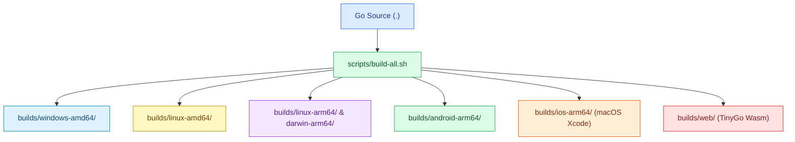
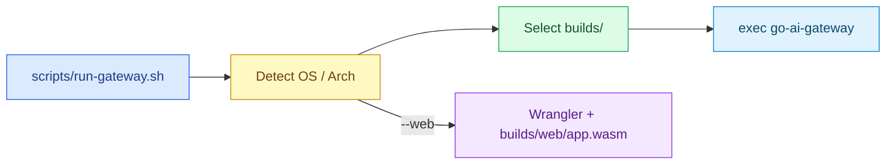

# Cross-Platform Builds (`docs/cross-platform-builds.md`)

Go AI Gateway uses Go's native cross-compilation (`GOOS`/`GOARCH`) and TinyGo WebAssembly to produce standalone binaries for **Windows**, **Linux**, **ARM64**, **Android**, **iOS**, and **Web (Wasm)** inside the `builds/` directory.



## Build Matrix

| Target | Output Path | Toolchain | Notes |
| --- | --- | --- | --- |
| **Windows (x64)** | `builds/windows-amd64/go-ai-gateway.exe` | `CGO_ENABLED=0 GOOS=windows GOARCH=amd64` | Standalone `.exe` |
| **Linux (x64)** | `builds/linux-amd64/go-ai-gateway` | `CGO_ENABLED=0 GOOS=linux GOARCH=amd64` | Static binary |
| **ARM64 (Linux)** | `builds/linux-arm64/go-ai-gateway` | `CGO_ENABLED=0 GOOS=linux GOARCH=arm64` | Raspberry Pi, AWS Graviton |
| **ARM64 (macOS)** | `builds/darwin-arm64/go-ai-gateway` | `CGO_ENABLED=0 GOOS=darwin GOARCH=arm64` | Apple Silicon |
| **Android (ARM64)** | `builds/android-arm64/go-ai-gateway` | `CGO_ENABLED=0 GOOS=android GOARCH=arm64` | Termux / embedded Android |
| **iOS (ARM64)** | `builds/ios-arm64/go-ai-gateway` | `CGO_ENABLED=1 GOOS=ios GOARCH=arm64` | Requires macOS + Xcode SDK |
| **Web (Wasm)** | `builds/web/app.wasm` | `tinygo build -target wasm -no-debug .` | Cloudflare Workers / Pages |

## Building & Running Dynamically



```bash
# 1. Build all targets into builds/
./scripts/build-all.sh

# 2. Dynamically detect OS/architecture and run the matching binary
./scripts/run-gateway.sh

# 3. Launch the WebAssembly build locally via Wrangler
./scripts/run-gateway.sh --web
```

