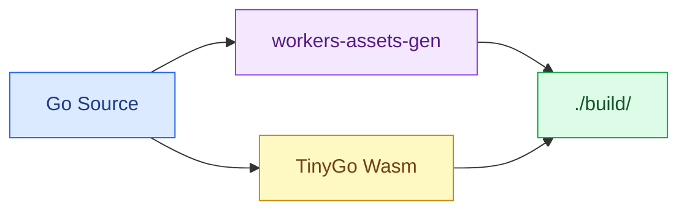
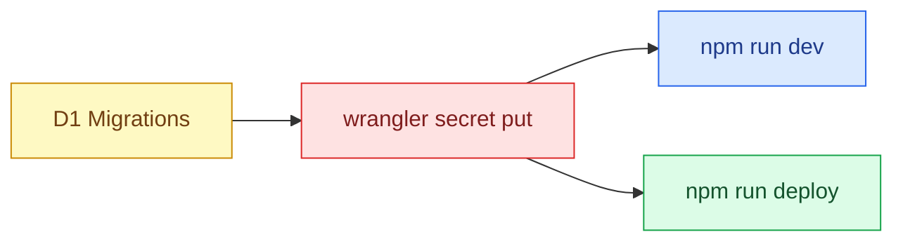

# Deploying to Cloudflare Workers (TinyGo + D1 + Workers AI)

> **Fastest Path**: Use [deploy-cloudflare.sh](../deploy-cloudflare.sh) (or [deploy-company.sh](../deploy-company.sh) for enterprise production) with your API keys in `.env` — see [Where & How to Deploy + Cloudflare Pages Live Demo Guide](cloudflare-pages-demo.md).

## Prerequisites

- **Go** `1.24+`
- **TinyGo** `0.42+` (builds `net/http` to `-target wasm`)
- **Node.js** `18+` and **Wrangler** (`npm install`)
- A Cloudflare account with **Workers**, **D1**, and **Workers AI** enabled

## 1. Install Node Dependencies & Build TinyGo Wasm



```bash
npm install
make build-wasm
```

This runs:
1. `go run github.com/syumai/workers-go/cmd/workers-assets-gen` -> generates `./build/worker.mjs`, `./build/runtime.mjs`, and `./build/wasm_exec.js`.
2. `tinygo build -o ./build/app.wasm -target wasm -no-debug ./...` -> compiles the Go gateway to a compact Wasm binary (`~2.3 MB` uncompressed).

## 2. Create & Migrate the D1 Database

```bash
npx wrangler d1 create ai-gateway-db
```

Copy the printed `database_id` into [wrangler.jsonc](../wrangler.jsonc):

```jsonc
  "d1_databases": [
    {
      "binding": "DB",
      "database_name": "ai-gateway-db",
      "database_id": "<YOUR_D1_DATABASE_ID>",
      "migrations_dir": "migrations"
    }
  ]
```

Apply the schema (and optional demo team seed in `migrations/0002_seed.sql`):

```bash
# Local Miniflare D1 (for wrangler dev)
npm run db:migrate:local

# Remote Cloudflare D1 (for production)
npm run db:migrate:remote
```

> **Production Security Note**: Before migrating remote production D1, remove or replace the demo keys in `migrations/0002_seed.sql` and provision real team API keys via `POST /admin/teams`.

## 3. Configure Secrets



For local `wrangler dev`, copy `.dev.vars.example` to `.dev.vars`:

```bash
cp .dev.vars.example .dev.vars
```

For production, set `ADMIN_TOKEN` and any external vendor keys you want enabled via `wrangler secret put`:

```bash
npx wrangler secret put ADMIN_TOKEN

# Optional external vendors (any unset vendor falls back to Workers AI):
npx wrangler secret put ANTHROPIC_API_KEY
npx wrangler secret put GEMINI_API_KEY
npx wrangler secret put XAI_API_KEY
npx wrangler secret put DEEPSEEK_API_KEY
npx wrangler secret put QWEN_API_KEY
npx wrangler secret put OPENAI_API_KEY
npx wrangler secret put MISTRAL_API_KEY
```

### Optional: Cloudflare AI Gateway Observability

To also mirror Workers AI calls through Cloudflare's AI Gateway analytics/caching layer, set `AI_GATEWAY_ID` in `wrangler.jsonc` under `"vars"`.

## 4. Run Locally with Wrangler or Deploy

```bash
# Local Cloudflare Workers simulator (Miniflare + D1 + Workers AI)
npm run dev

# Deploy to Cloudflare global network
npm run deploy
```

