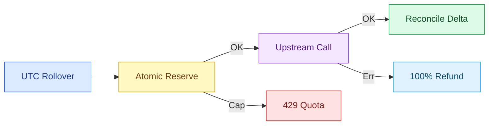
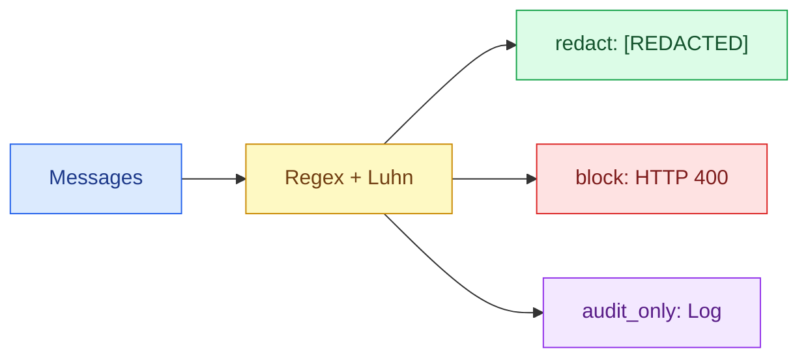
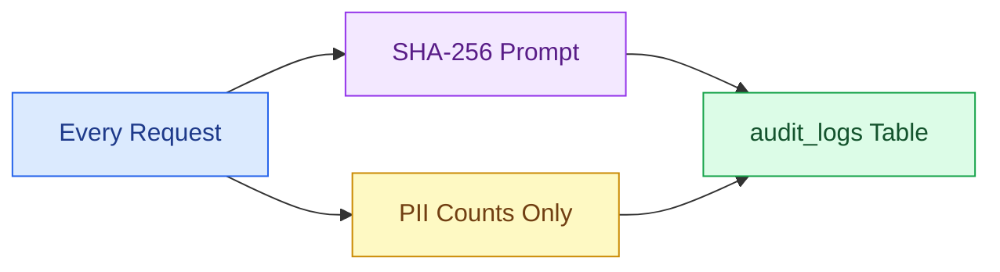

# Budgets, PII Redaction & Audit Policy

## Per-Team Budgets

All monetary values are stored and calculated in **integer micro-dollars** (`1 USD = 1,000,000 micros`) to eliminate floating-point rounding discrepancies across SQLite/D1 and Go.

### Budget Lifecycle



1. **Monthly Window (`period_ym`)**:
   - Each team has a `monthly_limit_micros`, `spent_micros`, and `period_ym` (`YYYY-MM` in UTC).
   - When a request arrives in a new UTC month, `spent_micros` automatically rolls over to `0` and `period_ym` updates to the current month.

2. **Pre-Flight Atomic Reservation**:
   - Before calling any upstream model, the gateway computes `reserveMicros` as the worst-case cost (`prompt_tokens` + requested or default `max_tokens`) across the primary model and its fallback chain.
   - In D1, reservation executes a single atomic statement:
     ```sql
     UPDATE team_budgets
     SET spent_micros = spent_micros + ?, updated_at = ?
     WHERE team_id = ? AND enabled = 1 AND (spent_micros + ?) <= monthly_limit_micros
     ```
   - If `RowsAffected() == 0` because the cap would be exceeded, the gateway immediately returns `429 Too Many Requests` (`insufficient_quota`) and writes an audit record with `status = 'blocked_budget'`.

3. **Post-Flight Reconciliation & Refund**:
   - After inference succeeds, exact cost is computed from reported (or estimated) prompt and completion tokens:
     `cost_micros = ceil((prompt_tokens * input_micros_per_1m + completion_tokens * output_micros_per_1m) / 1,000,000)`
   - The delta `(actual_cost - reserve_micros)` is applied to `spent_micros`.
   - If all upstream candidates fail, `-reserve_micros` is refunded so failed requests never consume team quota.

## Personal-Data (PII) & Secret Protection



Every message is scanned by `internal/redact` **before** any model call or external HTTP request occurs.

### Detected Categories

| Category | Pattern / Validation | Example Placeholder |
| --- | --- | --- |
| `jwt` | 3-segment `eyJ...` base64url JWT | `[REDACTED_JWT_1]` |
| `api_key` | `sk-...`, `sk-proj-...`, `sk-ant-...`, `ghp_`/`gho_`/`ghu_`/`ghs_`, `github_pat_`, `AKIA...`, long `Bearer <token>` | `[REDACTED_API_KEY_1]` |
| `email` | Standard RFC-style email addresses | `[REDACTED_EMAIL_1]` |
| `ssn` | `AAA-GG-SSSS` (rejecting invalid `000`, `666`, `9xx` areas and `00`/`0000` segments) | `[REDACTED_SSN_1]` |
| `credit_card` | 13–19 digits (with spaces/dashes) verified by **Luhn checksum** to avoid false positives on order IDs | `[REDACTED_CREDIT_CARD_1]` |
| `phone` | International/North American phone formats (excluding ISO dates like `2026-11-16`) | `[REDACTED_PHONE_1]` |
| `ipv4` | Dotted-quad IPv4 with valid `0..255` octets | `[REDACTED_IPV4_1]` |

Placeholders are deduplicated per request session: if `alice@acme.com` appears twice in a conversation, both become `[REDACTED_EMAIL_1]`, preserving conversational context without exposing the underlying value.

### Team `pii_mode` Policies

- **`redact`** (default): Replaces detected PII/secrets with placeholders before sending to the model. Sets `X-Gateway-PII-Action: redacted`.
- **`block`**: Rejects the request with `400 Bad Request` (`pii_policy_violation`) whenever any PII or secret is detected, charges zero budget, and logs `status = 'blocked_pii'`.
- **`audit_only`**: Records finding counts and types in the audit log without mutating the prompt.

## Audit Log Guarantees



Every request—including `unauthorized`, `blocked_budget`, `blocked_pii`, `blocked_policy`, `upstream_error`, and `ok`—produces an entry in `audit_logs` containing:

- Request metadata (`id`, `created_at`, `team_id`, `tool_name`, `inbound_protocol`)
- Routing telemetry (`requested_model`, `routed_model`, `provider`, `route_reason`, `fallback_used`)
- Non-sensitive PII summary (`pii_detected` integer count, `pii_types_json` e.g. `{"email":1}`, `pii_action`) — **raw PII values are never logged**
- Usage & economics (`prompt_tokens`, `completion_tokens`, `total_tokens`, `cost_micros`, `latency_ms`)
- Tamper-evident `prompt_sha256` computed over the post-redaction prompt

