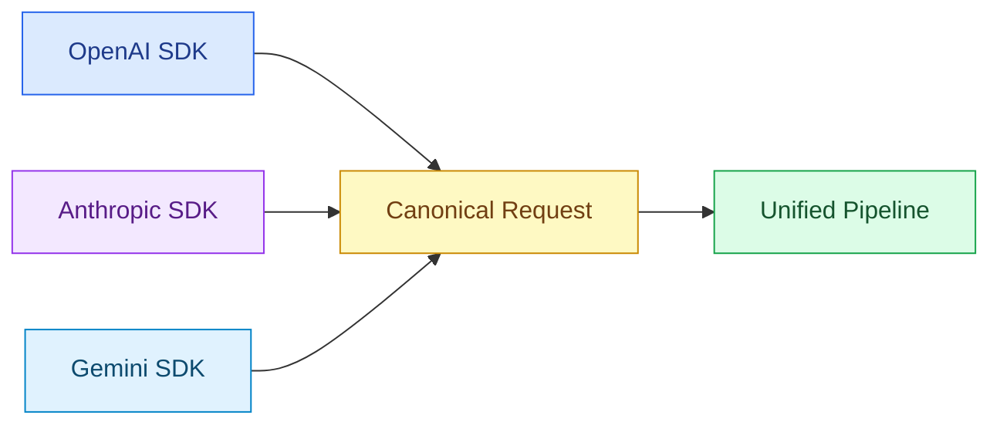
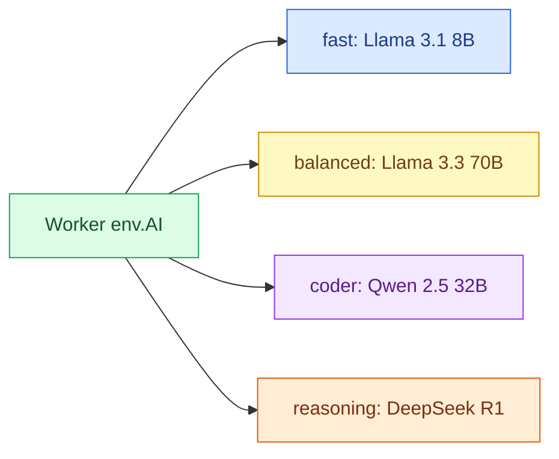
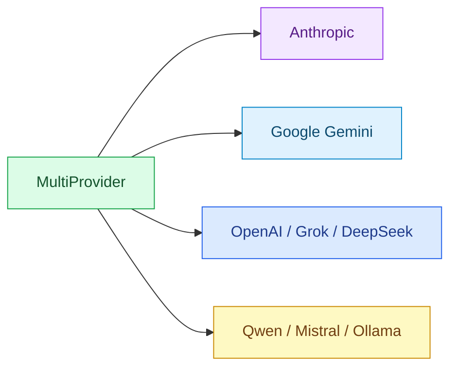
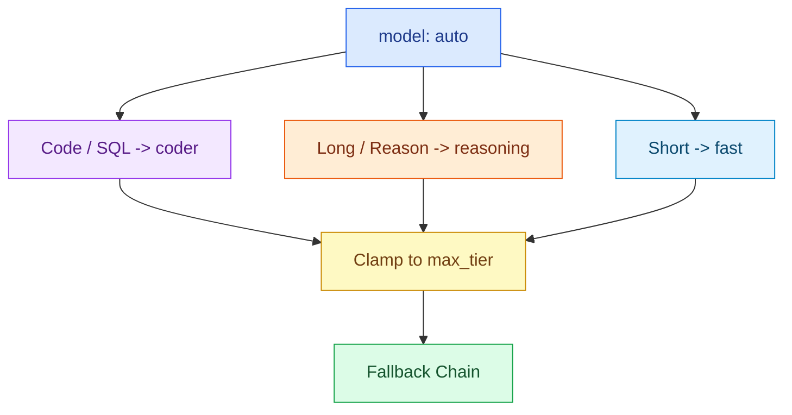

# Providers, Models & Routing

The gateway supports **both** multi-protocol inbound clients (OpenAI, Anthropic, Gemini) and multi-vendor upstream inference (**Cloudflare Workers AI / Meta**, **Anthropic**, **Google Gemini**, **xAI Grok**, **DeepSeek**, **Alibaba Qwen**, **OpenAI**, **Mistral**, and any custom OpenAI-compatible server).

## Supported Inbound SDK Protocols

Teams do not need to rewrite existing code to adopt the gateway:

| Inbound Endpoint | Compatible Clients | Team Auth Header |
| --- | --- | --- |
| `POST /v1/chat/completions` | OpenAI SDK, LangChain, LiteLLM clients, curl | `Authorization: Bearer <key>` or `X-Team-Key` |
| `POST /v1/messages` | Anthropic SDK (`ANTHROPIC_BASE_URL`) | `x-api-key: <key>`, `Authorization: Bearer`, or `X-Team-Key` |
| `POST /v1beta/models/{model}:generateContent` (and `/v1/models/...`) | Google Gemini SDK / REST | `x-goog-api-key: <key>`, `?key=<key>`, or `Authorization: Bearer` |

Every inbound request is translated into a canonical internal format, passes through the exact same PII redaction, budget reservation, routing, and audit pipeline, and is serialized back in the caller's expected response schema (with an optional `gateway` telemetry object and `X-Gateway-*` headers).

## Supported Upstream Providers & Models

### Cloudflare Workers AI (Meta, DeepSeek, Qwen, Mistral)

Always available inside Cloudflare Workers via the `env.AI` binding (zero external API keys required):

| Model ID | Aliases | Tier | Input / Output ($ per 1M tokens) |
| --- | --- | --- | --- |
| `@cf/meta/llama-3.1-8b-instruct-fast` | `fast`, `llama-8b`, `llama-3.1-8b`, `meta/llama-3.1-8b` | `fast` | \$0.045 / \$0.384 |
| `@cf/mistral/mistral-7b-instruct-v0.2` | `mistral-7b`, `workers/mistral-7b` | `fast` | \$0.110 / \$0.190 |
| `@cf/meta/llama-3.3-70b-instruct-fp8-fast` | `balanced`, `llama-70b`, `llama-3.3-70b`, `meta/llama-3.3-70b` | `balanced` | \$0.293 / \$2.253 |
| `@cf/meta/llama-4-scout-17b-16e-instruct` | `llama-4`, `llama-4-scout`, `meta/llama-4-scout` | `balanced` | \$0.270 / \$0.850 |
| `@cf/qwen/qwen2.5-coder-32b-instruct` | `coder`, `qwen-coder`, `qwen-2.5-coder` | `balanced` | \$0.660 / \$1.000 |
| `@cf/deepseek-ai/deepseek-r1-distill-qwen-32b` | `reasoning`, `deepseek-r1`, `r1` | `reasoning` | \$0.497 / \$4.881 |

### External Vendor Providers

Configure any combination of vendor keys as Worker secrets (or environment variables in local mode):

| Provider | Env Secret(s) | Supported Models & Aliases | Native Protocol |
| --- | --- | --- | --- |
| **Anthropic** | `ANTHROPIC_API_KEY` (optional `ANTHROPIC_BASE_URL`) | `claude-haiku-4-5` (`claude-haiku`, `claude-3-5-haiku`), `claude-sonnet-4-5` (`claude-sonnet`, `claude-3-7-sonnet`, `claude-3-5-sonnet`), `claude-opus-4-1` (`claude-opus`) | Anthropic `/v1/messages` |
| **Google Gemini** | `GEMINI_API_KEY` (optional `GEMINI_BASE_URL`) | `gemini-2.5-flash` (`gemini-flash`, `gemini-2.0-flash`), `gemini-2.5-pro` (`gemini-pro`) | Gemini `:generateContent` |
| **xAI Grok** | `XAI_API_KEY` (optional `XAI_BASE_URL`) | `grok-3-mini` (`grok-mini`), `grok-3` (`grok`, `grok-2`) | OpenAI-compatible (`api.x.ai`) |
| **DeepSeek** | `DEEPSEEK_API_KEY` (optional `DEEPSEEK_BASE_URL`) | `deepseek-chat` (`deepseek`, `deepseek-v3`), `deepseek-reasoner` (`deepseek-r1-api`) | OpenAI-compatible (`api.deepseek.com`) |
| **Alibaba Qwen** | `QWEN_API_KEY` or `DASHSCOPE_API_KEY` (optional `QWEN_BASE_URL`) | `qwen-turbo`, `qwen-plus` (`qwen`), `qwen-max` | OpenAI-compatible (DashScope) |
| **OpenAI** | `OPENAI_API_KEY` (optional `OPENAI_BASE_URL`) | `gpt-4o-mini` (`gpt-3.5-turbo`), `gpt-4o`, `o3-mini` (`o1`) | OpenAI-compatible (`api.openai.com`) |
| **Mistral** | `MISTRAL_API_KEY` (optional `MISTRAL_BASE_URL`) | `mistral-large-latest` (`mistral-large`) | OpenAI-compatible (`api.mistral.ai`) |
| **Custom OpenAI-Compat** | `UPSTREAM_BASE_URL` (optional `UPSTREAM_API_KEY`) | Any custom model ID (Ollama, vLLM, OpenRouter, LiteLLM) | OpenAI-compatible |

## Intelligent Routing & Fallback Rules

1. **Automatic Routing (`model: "auto"` or empty)**:
   - `route_hint: "cost"` or `"latency"` (or header `X-Gateway-Route: cost|latency`) selects `fast`.
   - `route_hint: "quality"` selects `reasoning`.
   - Code/SQL detection (`select `, `join `, `sql`, `golang`, `typescript`, `python`, `refactor`, `stack trace`, `compile error`) selects `coder` (`@cf/qwen/qwen2.5-coder-32b-instruct`).
   - Long prompts (> 900 estimated tokens) or reasoning keywords (`step by step`, `architect`, `trade-off`, `root cause`, `prove`) select `reasoning`.
   - Medium prompts (> 220 tokens or > 2 messages) select `balanced`.
   - Short prompts default to `fast`.
   - Adding `X-Gateway-Provider: <vendor>` (or JSON `"provider_hint"`) routes `auto` to the matching tier on that vendor if configured.

2. **Team Tier Caps (`max_tier`)**:
   - Tiers rank as `fast (1) < balanced (2) < reasoning (3)`.
   - When `model: "auto"` selects a tier above the team's `max_tier`, the router **clamps** down to the team's `max_tier`.
   - When a caller **explicitly** requests a model above `max_tier` (e.g., a `fast`-only team requesting `claude-opus-4-1` or `grok-3`), the gateway blocks the request with `403 Forbidden` and logs `status = blocked_policy`.

3. **Unconfigured Provider Substitution & Strict Mode**:
   - If a tool requests `claude-sonnet-4-5` when `ANTHROPIC_API_KEY` is not configured, the gateway substitutes its tier-matched Workers AI fallback (`@cf/meta/llama-3.3-70b-instruct-fp8-fast`) by default.
   - To fail closed instead of substituting, send `X-Gateway-Strict-Provider: true` (returns `503 provider_unavailable`).

4. **Runtime Fallback Chain**:
   - If the primary upstream returns an error (5xx, timeout, rate limit), the gateway automatically retries each fallback candidate that respects the team's `max_tier`, sets `fallback_used: true` in the audit log, and bills at the **actual** succeeding model's price.

