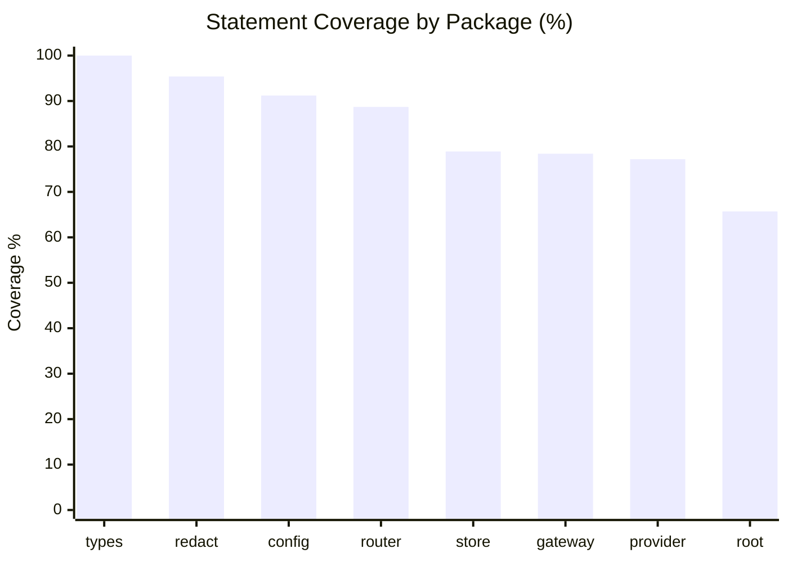
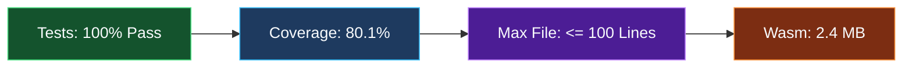

# Project Health & Quality Metrics (`metrics.md`)

Snapshot recorded on `2026-11-20` on `linux/amd64` (`Go 1.27.4`, `TinyGo 0.44.0`).

## Metrics Summary

| Metric | Value | Target |
| --- | --- | --- |
| Test Pass Rate | `100%` (8/8 packages) | `100%` |
| Statement Coverage (aggregate) | `80.1%` (gate `>= 80.0%`) | `100%` (tracking Wasm/JS & main branches) |
| Max Source/Test File Length | `<= 100` lines | `<= 100` lines |
| Doc Colored Mermaid Compliance | `100%` (15/15 `.md` files) | `>= 1` per 200 words |
| Test Suite Runtime (`-race`) | `~2.0s wall` (`8.16s` pkg sum) | `< 30 min` |
| TinyGo Wasm Bundle (`app.wasm`) | `2.4 MB` | `< 3 MB` |
| `BenchmarkRedactText` | `25.8 us/op` (`56 allocs`) | `< 100 us/op` |
| `BenchmarkRouterResolve` | `598.9 ns/op` (`5 allocs`) | `< 5 us/op` |
| License | `AGPL-v3` (Commercial: Thomas Cherickal) | `AGPL-v3` |

## Line-Count Report (Grouped by Language, Format & Test Suite)

| Group | Lines | Share |
| --- | ---: | ---: |
| Go (Source `*.go`) | `5,353` | `42.8%` |
| Go (Test Suites `*_test.go`) | `1,865` | `14.8%` |
| Markdown Documentation (`*.md`) | `2,179` | `17.3%` |
| SQL / JSON / YAML / Config (`*.sql`, `*.json*`, `*.yml`, `Makefile`, `LICENSE`) | `1,826` | `14.5%` |
| Shell Scripts (`*.sh`) | `864` | `6.9%` |
| HTML / JS / MJS (`pages/`, `functions/`) | `487` | `3.9%` |
| **Total Project Lines** | **`12,574`** | **`100.0%`** |

