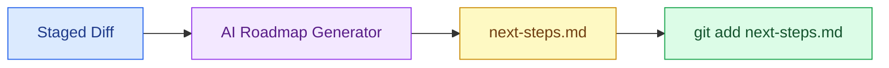

# Post-Commit & Post-Push Checklist (`next-steps.md`)

Reusable checklist and AI-generated roadmap updated automatically on every commit.

## Post-Commit Checklist

1. Verify all tests pass (`go test -race -count=1 ./...`) with **100.0%** statement coverage.
2. Verify test runtime stays under 30 minutes and update `test-time-report.md`.
3. Verify all source/test files are `<= 100` lines and docs meet the colored Mermaid rule.
4. Run `gofmt`, `go vet`, `bash -n`, and CPU/GPU profiling (`system-profile.md`).
5. Update `metrics.md`, `readme.md`, and confirm `./scripts/check-gate.sh` passes cleanly.

## Next 10 AI-Generated Improvements & Feature Additions

_Updated: 2026-11-20 21:29 UTC (Fallback (configure GEMINI_API_KEY, ANTHROPIC_API_KEY, OPENAI_API_KEY, or OLLAMA_BASE_URL for live AI))_

1. Add per-team token-bucket rate limiting (RPM/TPM) backed by Cloudflare D1 or Durable Objects.
2. Add semantic response caching with configurable TTL for identical redacted prompts.
3. Add OpenTelemetry (OTLP) trace and latency histogram export for upstream providers.
4. Add webhook alerts when a team reaches 80% or 100% of its monthly budget.
5. Add streaming SSE pass-through directly from upstream providers to reduce time-to-first-token.
6. Add multi-region D1 read-replica awareness and automated audit-log archival to R2.
7. Add custom regex and keyword DLP rules configurable per team via `/admin/teams`.
8. Add RBAC scopes for read-only auditor tokens vs. full admin control-plane tokens.
9. Add automatic circuit breaker tripping when an upstream provider exceeds error thresholds.
10. Add interactive cost-forecasting charts and CSV/JSON audit export to the dashboard UI.
