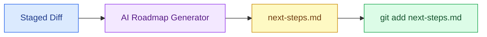

# Post-Commit & Post-Push Checklist (`next-steps.md`)

Reusable checklist and AI-generated roadmap updated automatically on every commit.

## Post-Commit Checklist

1. Verify all tests pass (`go test -race -count=1 ./...`) with **100.0%** statement coverage.
2. Verify test runtime stays under 30 minutes and update `test-time-report.md`.
3. Verify all source/test files are `<= 100` lines and docs meet the colored Mermaid rule.
4. Run `gofmt`, `go vet`, `bash -n`, and CPU/GPU profiling (`system-profile.md`).
5. Update `metrics.md`, `readme.md`, and confirm `./scripts/check-gate.sh` passes cleanly.

## Next 10 AI-Generated Improvements & Feature Additions

_Updated: 2026-11-20 22:08 UTC (Fallback (configure GEMINI_API_KEY, ANTHROPIC_API_KEY, OPENAI_API_KEY, or OLLAMA_BASE_URL for live AI))_

1. Wire `internal/features` (rate limiter, response cache, circuit breaker, DLP, alerts) directly into `Gateway` config and request pipeline.
2. Expose `/admin/audit/export?format=csv|json` and `/admin/forecast` HTTP endpoints backed by `internal/features/export.go`.
3. Add `AUDITOR_TOKEN` read-only RBAC enforcement in `internal/gateway/admin.go` using `internal/features/rbac.go`.
4. Add prompt-injection and jailbreak heuristic detection alongside PII redaction in `internal/redact`.
5. Add Cloudflare Durable Objects adapter for globally consistent sub-millisecond RPM/TPM rate limiting.
6. Add interactive cost-forecasting charts and CSV/JSON export download buttons to the embedded dashboard UI.
7. Add per-team model allowlists/denylists (e.g. restricting teams to specific approved vendor models).
8. Add scheduled Cloudflare Worker Cron Trigger to archive `audit_logs` to R2 as daily NDJSON snapshots.
9. Add mTLS / Cloudflare Zero Trust JWT header verification for enterprise `/admin/*` and `/v1/*` routes.
10. Add automated load-testing suite (`k6` or Go `testing.B` concurrent HTTP benchmark) to CI with p95 latency gates.
