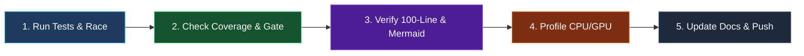

# Post-Commit & Post-Push Checklist (`next-steps.md`)

Reusable checklist executed after every commit and push in `go-ai-gateway`.

## Checklist

1. Verify all unit, integration, smoke, E2E, security, and benchmark tests pass (`go test -race -count=1 ./...`).
2. Confirm coverage meets the CI gate and work toward 100% statement coverage with zero regressions.
3. Verify total test runtime is under 30 minutes and update `test-time-report.md`.
4. Verify all source and test files are <= 100 lines (`./scripts/check-line-limit.sh`) and all docs satisfy the Mermaid rule (`./scripts/check-docs-mermaid.sh`).
5. Review for duplicate code, dead code, and per-commit optimizations.
6. Run `gofmt -l .`, `go vet ./...`, and `bash -n`.
7. Profile CPU/GPU usage and update `system-profile.md`.
8. Confirm `./scripts/check-gate.sh` and `.githooks/pre-commit` pass cleanly.
9. Update `metrics.md` with latest coverage, latency, and binary size metrics.
10. Update `readme.md` for any architectural or CLI changes.
11. Review this checklist for next-iteration follow-ups (raising statement coverage to 100%).
12. Commit and push changes to `origin/main`.

