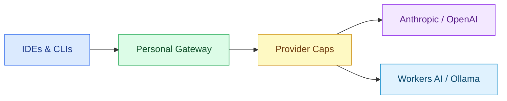
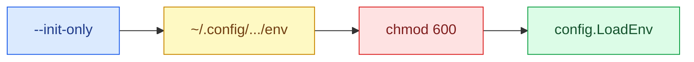
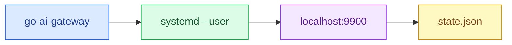
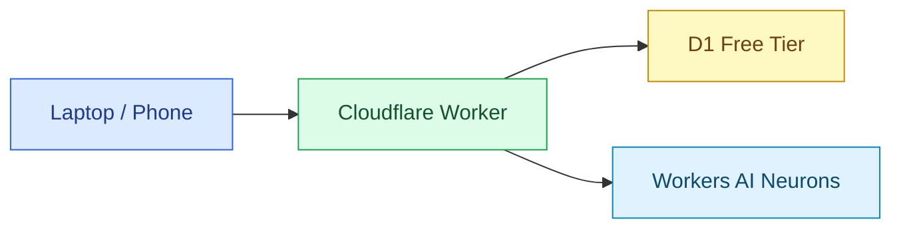
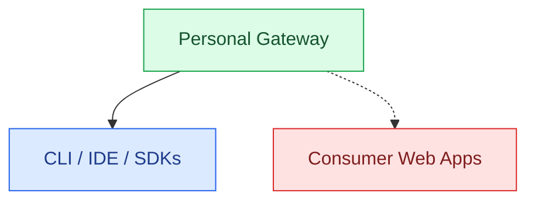
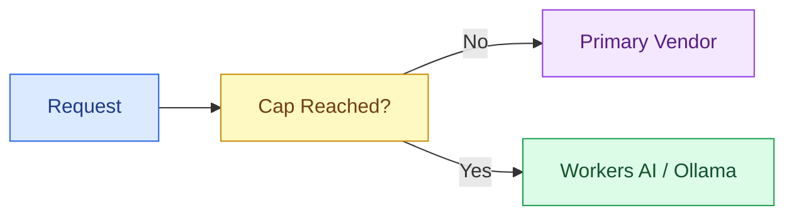

# Personal Multi-Subscription Deployment Guide (`personal-deployment.md`)

This guide explains how to deploy **Go AI Gateway** for personal use when you hold API credits or subscriptions across multiple AI companies (**Anthropic**, **Google Gemini**, **xAI Grok**, **OpenAI**, **DeepSeek**, **Alibaba Qwen**, **Mistral**) alongside free/local options (**Cloudflare Workers AI** and local **Ollama**).

Instead of configuring API keys and spending limits separately in every IDE, CLI tool, and script, you run one personal gateway that:
- Keeps all vendor API keys in **one encrypted/permission-restricted place**
- Enforces **per-provider monthly spend caps** (`PROVIDER_LIMITS_USD`, e.g., `$5/mo` on Anthropic, `$5/mo` on OpenAI, `$3/mo` on Grok)
- Automatically **spills over to cheaper, free (Workers AI), or $0 local (Ollama) models** once a vendor reaches its monthly cap
- Redacts your personal emails, keys, tokens, and IP addresses before prompts leave your machine
- Persists your spend history and audit log locally across restarts (no database server required)

> **One-Command Automation (`deploy-personal.sh`)**:
> ```bash
> ./deploy-personal.sh --init-only                     # Creates ~/.config/go-ai-gateway/env (chmod 600) with random tokens
> # Edit ~/.config/go-ai-gateway/env to add your AI company API keys, then run one of:
> ./deploy-personal.sh --mode local --install-service  # Local binary + systemd user service + FileStore
> ./deploy-personal.sh --mode cloudflare               # Personal Worker + D1 + Workers AI Free Tier
> ./deploy-personal.sh --mode pages                    # Personal Worker + Cloudflare Pages dashboard
> ```

---

## Option A: Local Machine / Home Server (`PERSONAL_MODE=true`)



Best if you want everything running on `localhost:9900` (laptop, Mac Mini, home lab, or personal VPS) with zero cloud setup.

### 1. Create Your Personal Env File



Create `~/.config/go-ai-gateway/env` (or `.env.personal` in the project directory) with restricted permissions (`chmod 600`):

```bash
mkdir -p ~/.config/go-ai-gateway
cat > ~/.config/go-ai-gateway/env <<'EOF'
# Enable personal single-user mode + durable JSON state persistence
PERSONAL_MODE=true
PERSONAL_API_KEY=gw_personal_secret_change_me
PERSONAL_MONTHLY_BUDGET_USD=30
PERSONAL_PII_MODE=redact
PERSONAL_MAX_TIER=reasoning
ADMIN_TOKEN=gw_admin_personal_change_me
GATEWAY_DATA_FILE=/home/YOUR_USER/.config/go-ai-gateway/state.json

# Cap each AI company individually so you never get a surprise bill.
# When a vendor hits its cap, requests overflow to Workers AI or local Ollama.
PROVIDER_LIMITS_USD=anthropic=5,openai=5,gemini=3,grok=3,deepseek=2,qwen=2

# Add keys only for the AI companies you subscribe to:
ANTHROPIC_API_KEY=sk-ant-...
GEMINI_API_KEY=AIza...
XAI_API_KEY=xai-...
OPENAI_API_KEY=sk-...
DEEPSEEK_API_KEY=sk-...
QWEN_API_KEY=sk-...
MISTRAL_API_KEY=...

# Optional: Cloudflare Workers AI via REST (uses Cloudflare's free daily Neurons)
# CF_ACCOUNT_ID=...
# CF_API_TOKEN=...

# Optional: Local Ollama ($0/token overflow & offline fallback)
OLLAMA_BASE_URL=http://localhost:11434/v1
EOF
chmod 600 ~/.config/go-ai-gateway/env
```

> **How `.env` loading works**: `internal/config/env.go` automatically checks `.env.personal`, `.env`, and `~/.config/go-ai-gateway/env` on startup without overwriting variables already exported in your shell.

### 2. Build and Run

```bash
go build -o go-ai-gateway .
./go-ai-gateway
```

Your personal gateway starts on `http://localhost:9900` (change via `PORT=8080`). All budgets, spend counters, and audit logs persist atomically to `GATEWAY_DATA_FILE` (`internal/store/file.go`).

### 3. Run in the Background (`systemd` user service on Linux)



```ini
# ~/.config/systemd/user/go-ai-gateway.service
[Unit]
Description=Personal Go AI Gateway
After=network.target

[Service]
ExecStart=/usr/local/bin/go-ai-gateway
Restart=on-failure
RestartSec=3

[Install]
WantedBy=default.target
```

```bash
systemctl --user daemon-reload
systemctl --user enable --now go-ai-gateway
```

---

## Option B: Personal Cloudflare Workers Free Tier (Zero-Server, Multi-Device)



Best if you want your personal gateway reachable from your laptop, phone, and remote servers without keeping a machine running at home.

Cloudflare Workers Free Tier + D1 Free Tier + Workers AI free daily Neurons handle typical personal traffic at **$0 hosting cost**:

```bash
npm install
make build-wasm
npx wrangler d1 create personal-ai-gateway-db
# Paste database_id into wrangler.jsonc
npx wrangler d1 execute personal-ai-gateway-db --remote --file=./migrations/0001_init.sql

# Set your personal admin token, per-provider caps, and vendor keys:
npx wrangler secret put ADMIN_TOKEN
npx wrangler secret put PROVIDER_LIMITS_USD   # e.g. anthropic=5,openai=5,grok=3
npx wrangler secret put ANTHROPIC_API_KEY
npx wrangler secret put GEMINI_API_KEY
npx wrangler secret put XAI_API_KEY
npx wrangler secret put DEEPSEEK_API_KEY
npx wrangler secret put QWEN_API_KEY
npx wrangler secret put OPENAI_API_KEY

npm run deploy
```

Then create your personal API profile against the deployed Worker:

```bash
curl -X POST https://go-ai-gateway.<your-subdomain>.workers.dev/admin/teams \
  -H "Authorization: Bearer $ADMIN_TOKEN" \
  -H "Content-Type: application/json" \
  -d '{
    "team_id": "personal",
    "team_name": "Personal",
    "api_key": "gw_personal_secret_change_me",
    "monthly_limit_micros": 30000000,
    "max_tier": "reasoning",
    "pii_mode": "redact"
  }'
```

---

## Configuring Your Personal Tools (What Works vs. What Doesn't)



### Supported Developer Tools & Coding Agents

The gateway supports **SSE streaming**, **tool/function calling** (`tools`, `tool_use`, `tool_result`, `functionDeclarations`), and **`POST /v1/messages/count_tokens`**, so developer CLIs, IDEs, and SDKs work directly:

| Tool / Client | Works? | Configuration |
| --- | --- | --- |
| **Claude Code** (API key mode) | **Yes** | `ANTHROPIC_BASE_URL=http://localhost:9900` + `ANTHROPIC_API_KEY=$PERSONAL_API_KEY` |
| **Google Antigravity CLI & Python SDK** | **Yes** | `GOOGLE_GEMINI_BASE_URL=http://localhost:9900` + `GEMINI_API_KEY=$PERSONAL_API_KEY` (or `LocalOpenAIAgentConfig(base_url="http://localhost:9900/v1", api_key=...)`) |
| **Gemini CLI / Google GenAI SDK** | **Yes** | `GOOGLE_GEMINI_BASE_URL=http://localhost:9900` + `GEMINI_API_KEY=$PERSONAL_API_KEY` |
| **Cursor / Cline / Continue / Aider / Codex CLI** | **Yes** | OpenAI base URL `http://localhost:9900/v1` + API key `$PERSONAL_API_KEY` |
| **OpenAI / Anthropic / Gemini Python & Node SDKs** | **Yes** | Point `base_url` to gateway + pass `$PERSONAL_API_KEY` |
| **Local Ollama models** | **Yes** | Pass `"model": "ollama/llama3.2"` or `"model": "ollama/<your-pulled-model>"` |

### Consumer Apps That Cannot Be Routed Through Any Gateway

| App | Works? | Why |
| --- | --- | --- |
| **Claude Chat (`claude.ai`) & Claude Desktop (main chat)** | **No** | Uses first-party consumer OAuth/session login to Anthropic's web endpoints and does not expose `ANTHROPIC_BASE_URL`. *(Note: custom MCP servers inside Claude Desktop can still call this gateway.)* |
| **Gemini Web/Mobile App & Gemini Desktop** | **No** | Uses Google account OAuth/session auth and proprietary first-party endpoints rather than `GEMINI_API_KEY` / `GOOGLE_GEMINI_BASE_URL`. |
| **Antigravity IDE UI (consumer Google login)** | **No** | Bound to managed Google account / seat auth rather than arbitrary third-party API URLs (unless configured with an enterprise gateway override by IT). |
| **ChatGPT Web/Desktop App & Grok Web/Mobile App** | **No** | Consumer subscription UIs use proprietary session auth and certificate-pinned/first-party endpoints, not `OPENAI_BASE_URL` / `XAI_API_KEY`. |

---

## Monitoring Personal Spend & Provider Caps



- **Web Dashboard**: Open `http://localhost:9900/`, enter your `ADMIN_TOKEN`, and inspect spend, PII redactions, and recent calls.
- **Per-Provider Cap Status**:
  ```bash
  curl -s http://localhost:9900/admin/providers \
    -H "Authorization: Bearer $ADMIN_TOKEN" | jq .
  ```
  Example output:
  ```json
  {
    "period_ym": "2026-11",
    "provider_spend_micros": {
      "anthropic": 5004200,
      "workers-ai": 12000
    },
    "provider_caps_micros": {
      "anthropic": 5000000,
      "openai": 5000000,
      "grok": 3000000
    }
  }
  ```
  Notice `anthropic` reached its `$5.00` cap (`5000000` micros), so subsequent `claude-sonnet-4-5` requests automatically overflow to `workers-ai` (`@cf/meta/llama-3.3-70b-instruct-fp8-fast`) unless `X-Gateway-Strict-Provider: true` is sent.

