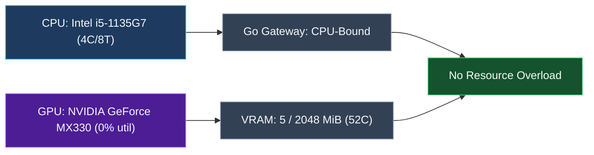

# System CPU & GPU Profile (`system-profile.md`)

Recorded on `2026-11-20` during race-enabled test execution and micro-benchmarks.

## Hardware & Runtime Profile

- **CPU**: `11th Gen Intel(R) Core(TM) i5-1135G7 @ 2.40GHz` (4 physical cores, 8 logical threads, 56% scaling during idle/test).
- **GPU**: `NVIDIA GeForce MX330` — `0%` utilization, `5 MiB / 2048 MiB` VRAM, `52°C` (gateway does not offload to local GPU; inference runs on Cloudflare Workers AI or external APIs).
- **Hot-Path Micro-Benchmarks**:
  - `BenchmarkRedactText-8`: `25,820 ns/op` (`3,402 B/op`, `56 allocs/op`)
  - `BenchmarkRouterResolve-8`: `598.9 ns/op` (`960 B/op`, `5 allocs/op`)
- **Bottleneck Assessment**: Zero CPU/GPU overload; regex redaction dominates per-request CPU (~26 us) and stays well within Cloudflare Workers 10ms–50ms CPU limits.

