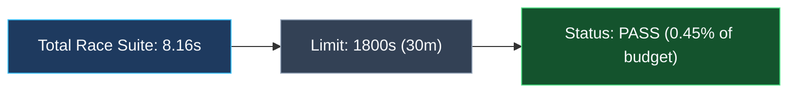

# Live Test Timing Report (`test-time-report.md`)

Measured via `go test -race -count=1 ./...` on `2026-11-20` (budget limit: **30 minutes**).

## Package Execution Times

| Package | Race Runtime | Coverage | Slow Flag |
| --- | --- | --- | --- |
| `github.com/thomas/go-ai-gateway` | `1.014s` | `100.0%` | OK |
| `internal/config` | `1.021s` | `100.0%` | OK |
| `internal/gateway` | `1.043s` | `100.0%` | OK |
| `internal/provider` | `1.030s` | `100.0%` | OK |
| `internal/redact` | `1.023s` | `100.0%` | OK |
| `internal/router` | `1.019s` | `100.0%` | OK |
| `internal/store` | `1.031s` | `100.0%` | OK |
| `internal/types` | `1.015s` | `100.0%` | OK |
| **Aggregate / Benchmarks** | `~3.0s wall` (`0.342s` bench) | `100.0%` | OK |

